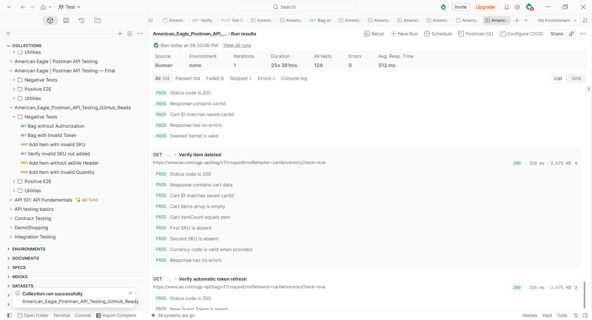

# American Eagle — Postman API Testing

[Русская версия](README_RU.md)

  

An **independent educational QA portfolio project** testing selected American Eagle REST API endpoints using Postman and JavaScript assertions. This project is not affiliated with or endorsed by American Eagle Outfitters. It exercises a guest shopping-bag workflow and API validation behavior; no real purchases are made.

## Technical stack

- **Postman** — API requests, collections, variables and Collection Runner.
- **JavaScript** — automated assertions and pre-request scripts.
- **REST API / JSON** — HTTP requests, response validation and data handling.
- **OAuth 2.0 / Bearer Token** — guest authentication and authorized API requests.
- **Postman Vault** — local storage of sensitive authentication credentials.
- **Git / GitHub** — version control and project documentation.

## Key features

- **End-to-end API testing:** complete guest shopping-bag workflow, from authentication to empty-cart verification.
- **Positive and negative scenarios:** successful operations, authorization errors, invalid SKU, missing headers and invalid quantity.
- **Automatic token refresh:** collection-level pre-request script obtains a new guest token when required.
- **Dynamic variables:** reuse of tokens, cart IDs and item IDs across requests.
- **Automated assertions:** 124 checks across 18 API requests in the verified local run.
- **Secure credential handling:** sensitive Basic credentials are stored in Postman Vault rather than the exported collection.

## Verified results

On **October 19, 2026**, the final, sanitized collection was executed **in one local Postman Collection Runner run** (one iteration):

| Suite | Requests | Passed assertions |
| --- | ---: | ---: |
| Positive E2E | 11 | 80 |
| Negative Tests | 6 | 42 |
| Utilities | 1 | 2 |
| **Total** | **18** | **124/124** |

**0 failed · 0 skipped · 0 Runner errors · 25.361 s total · 512 ms average response time.** These results describe one observed local run, not a CI guarantee or evidence that future API responses will remain unchanged.



## Test coverage

**Positive E2E:** obtain a guest OAuth token → add an item → read the cart → update the quantity → verify the update → add a second item → verify both items → delete the second item → verify removal → delete the remaining item → verify the empty cart. Assertions validate status codes, identifiers, SKU, quantity, item count, availability, currency when present, and errors.

**Negative Tests:** bag without authentication (`401`), invalid Bearer token (`401`), invalid SKU (`422`), verification that the invalid SKU was not added (`200`), missing `aeSite` header (`400`), and invalid quantity (`400`).

**Utilities:** one GET request checks the availability of a stored token and a successful bag response. The collection-level pre-request script can refresh an absent/expired guest token; this is not a standalone comprehensive token-expiration test.

## Repository layout

```text
American_Eagle_Postman_API_Tests/
├── postman/
│   └── American_Eagle.postman_collection.json
├── images/
│   └── postman-runner-results.png
├── README.md
├── README_RU.md
└── .gitignore
```

## Requirements and setup

1. Install **Postman Desktop** and import `postman/American_Eagle.postman_collection.json` (Collection v2.1).
2. Obtain **authorized** Basic credentials for the relevant guest OAuth endpoint. Do not use somebody else's credentials or include them in source control.
3. In **Postman Vault**, create a local secret named `ae_basic_auth` containing the complete header value `Basic <base64-encoded-credentials>`. Enable Vault use in scripts if prompted, and grant access only to this trusted collection when asked. The secret value is **not** part of the exported JSON.
4. The collection has editable sample `skuId` / `skuId2` values. Ensure both are currently valid, in stock, and distinct. `quantity=1` and `updatedQuantity=2` are also editable. Collection variables such as `token`, `cartId`, `itemId`, and `itemId2` start blank and are populated at runtime.
5. If network access requires a proxy, configure it in Postman. The shop's regional controls, cookies, and anti-automation defenses may affect requests.

## Run the tests

Use the collection **Run** menu, keep all **18 requests in their existing order**, choose **1 iteration**, and optionally add **500 ms** between requests. You may also run the individual folders: **Positive E2E**, **Negative Tests**, and **Utilities**. The invalid-SKU follow-up assumes an empty cart, so the full ordered run is preferable to arbitrary independent execution.

The `Get Guest Token` request and the collection pre-request script read `ae_basic_auth` from Postman Vault. On success, `token` and `token_expires_at` are saved as collection variables; later requests use Bearer `{{token}}`. The two intentionally unauthorized requests bypass refresh and use either no authorization or a deliberately invalid test token.

If you receive `401`, verify Vault access, credentials, and authorization scope. If you receive a `400`, check required headers (`aesite`, `aelang`, `aecountry`) and request payload. An invalid SKU is expected to result in `422` in the documented negative scenario.

## Security and limitations

- Never commit real Basic credentials, JWTs, cookies, exported environments containing secrets, or request logs with tokens.
- The collection JSON has no persisted bearer or Basic secret values, but **review every new export before committing**. Postman Vault access is local to your device and is not transferable by Git.
- Some assertions and SKU values depend on the live, third-party API and may need maintenance.
- This is **local Postman execution**, not continuous integration. Run responsibly and respect the service's terms and rate limits.

## Author

QA portfolio — [ISmeneger on GitHub](https://github.com/ISmeneger).
